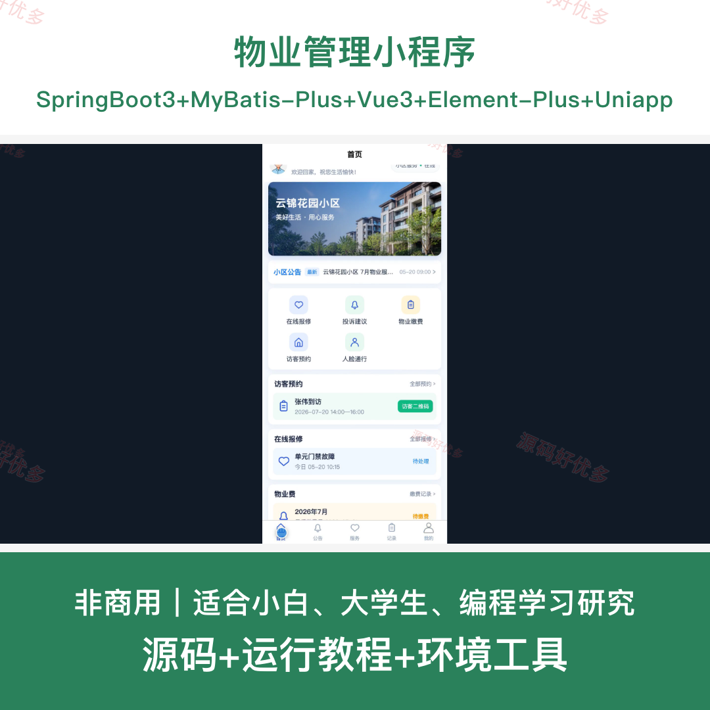
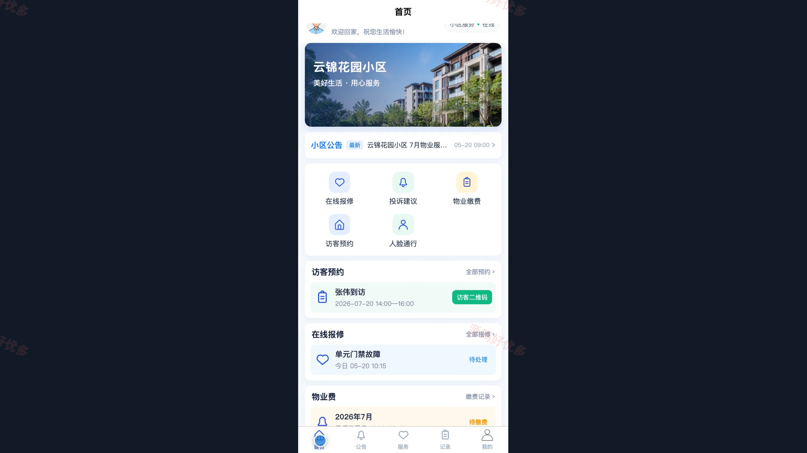
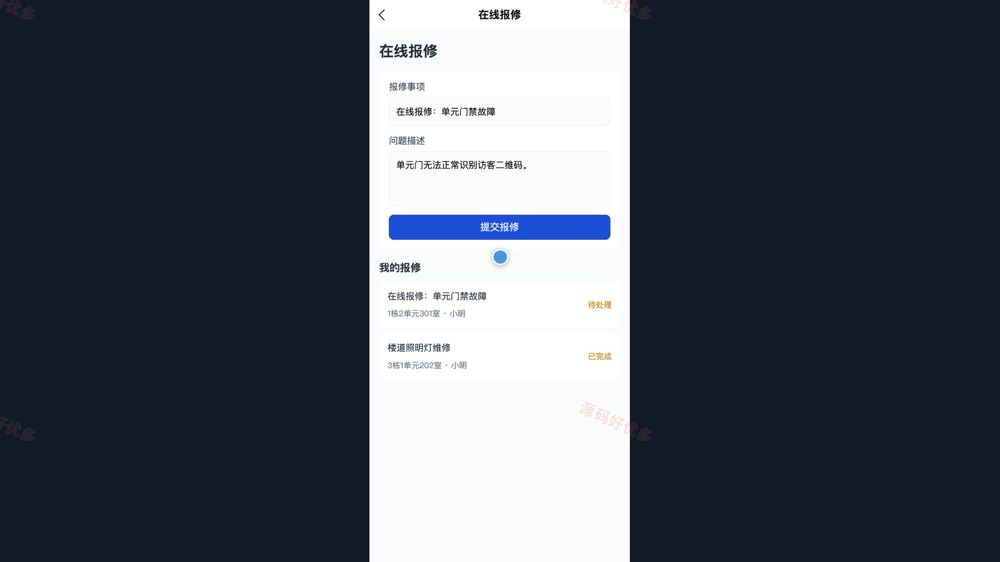
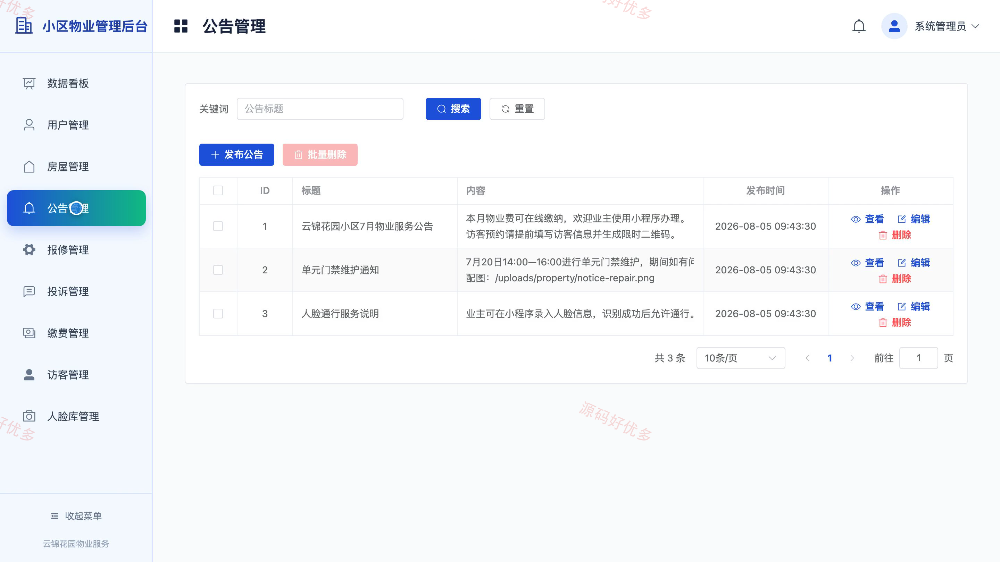
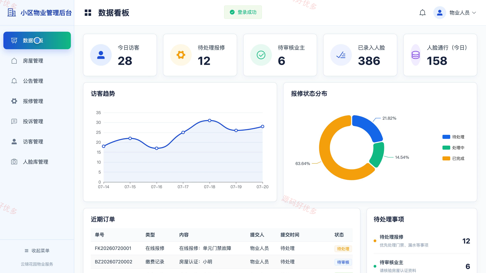
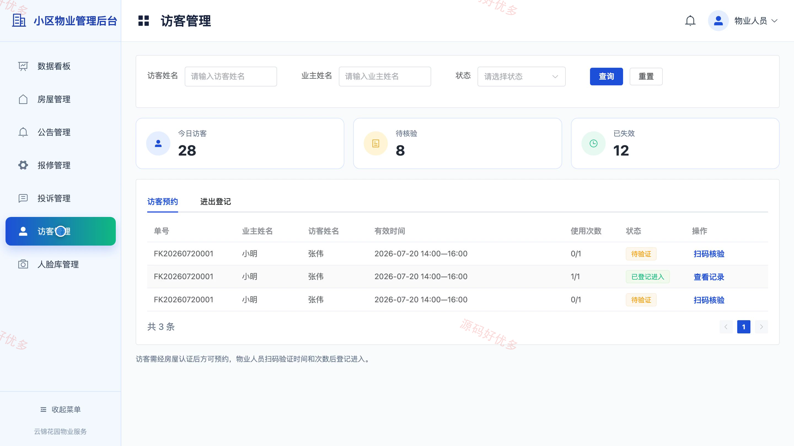

## 源码问题查看主页咨询

### 一、关键词
物业管理、智慧社区、小区服务、业主服务、访客通行

### 二、作品包含
源码+数据库+全套环境和工具资源+本地部署教程

### 三、项目技术
前端技术： Html、Css、Js、Vue3.4、Element-Plus、uniapp
后端技术：Java、SpringBoot3.2.0、MyBatis-Plus

### 四、运行环境（以下版本亲测，其他版本兼容性请自行测试）
开发工具：IDEA/eclipse + VSCODE + HBuilder X + 微信开发者工具

数据库：MySQL5.7+（共11张表）

数据库管理工具：Navicat10以上版本

环境配置软件： JDK17 + Maven3.6.3

前端Nodejs：16+

浏览器：谷歌浏览器

### 五、项目介绍
项目编号：bs031B

物业管理小程序面向管理员、业主、物业人员，提供项目核心业务等功能，实现各角色在系统中的实际业务协作。

角色：业主、物业人员、管理员

业主功能：小区公告浏览、物业服务查询、在线报修与进度记录、物业缴费记录查询、访客预约与二维码通行、人脸信息与通行记录、房屋认证信息、个人资料与密码管理。

物业人员功能：物业工作台、报修工单处理、业主与房屋信息核验、访客扫码核验、公告管理、投诉建议处理、人脸通行管理、运营数据查看。

管理员功能：运营数据看板、用户与角色管理、房屋信息管理、公告发布管理、报修与投诉管理、物业缴费管理、访客通行管理、人脸库管理。

### 六、运行截图

